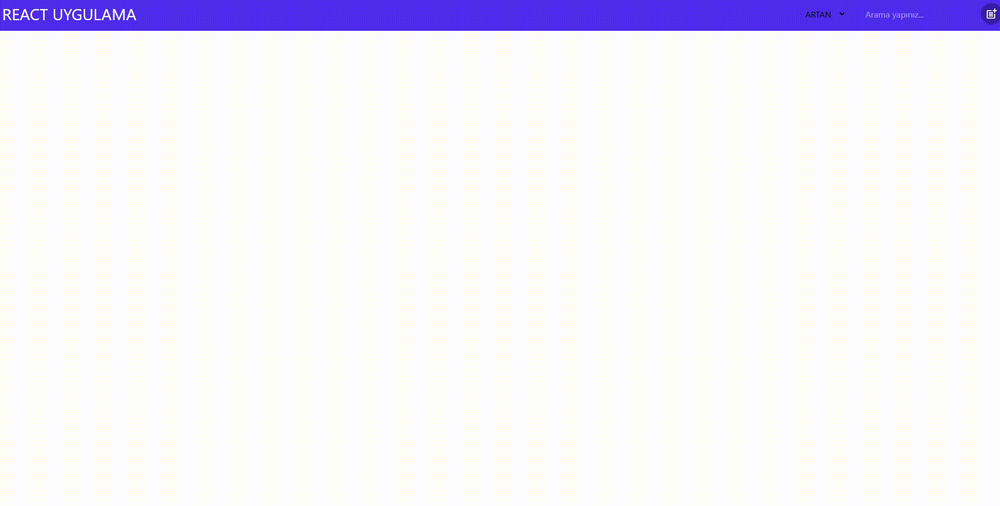

## 🚀 Proje Hakkında

Bu proje, bir modern web uygulaması geliştirmek için **React** ve global durum yönetimi için **Redux** (veya Redux Toolkit) kullanılarak oluşturulmuştur.

### 🖼️ Ekran Görüntüsü

**Kullanılan Temel Teknolojiler:**

- **React:** Kullanıcı arayüzü oluşturmak için bir JavaScript kütüphanesi.
- **React Router Dom:** Uygulama içinde sayfalar arası gezinme ve yönlendirme (Routing) için.
- **Redux/Redux Toolkit:** Uygulamanın durumunu yönetmek için öngörülebilir bir durum kapsayıcısı.
- **[Projenizin kullandığı diğer önemli kütüphaneler/araçlar - Örneğin: Vite, Axios, Tailwind CSS/Styled Components, vb.]**
